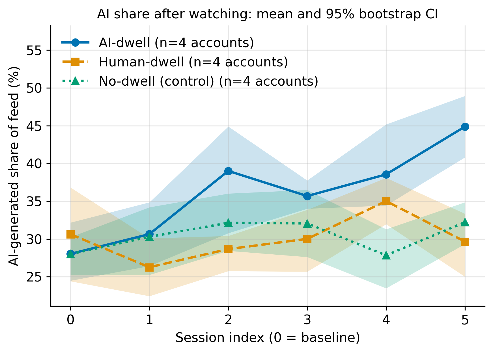
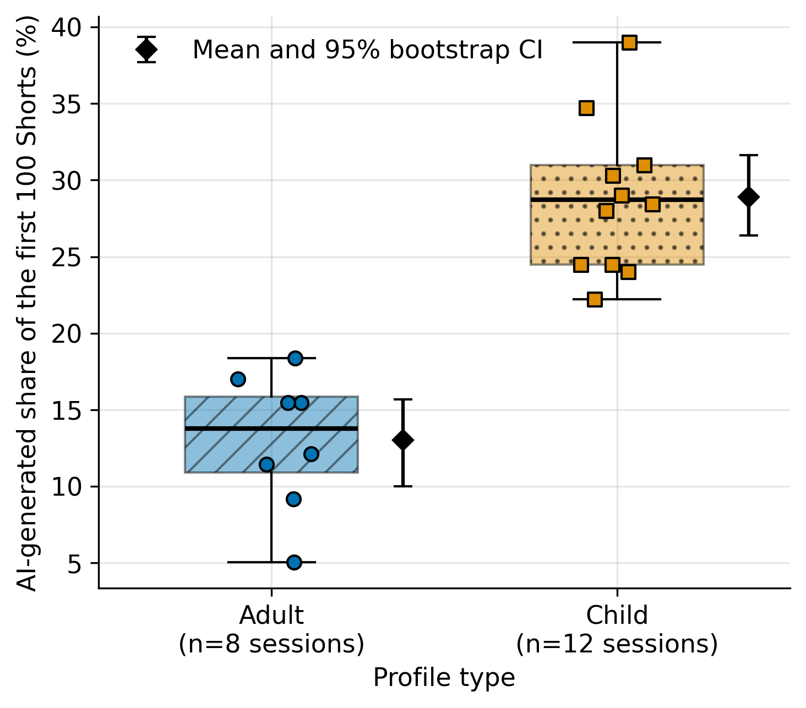
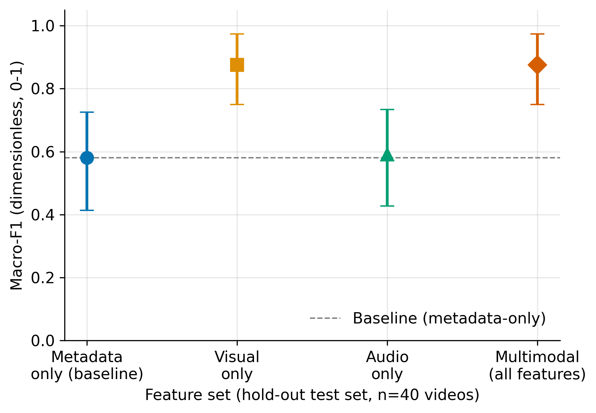

# Prevalence and Algorithmic Amplification of AI-Generated Child-Directed Shorts on YouTube

**Authors:** Zharas Suleiman
**Course:** Research Methods
**Methodology card:** [docs/methodology_card.md](docs/methodology_card.md)
**Domain model:** [docs/domain_model.md](docs/domain_model.md)

> **Important - demo data.** The files in `data/raw/` and `data/sample/` are **synthetic** (every record has `"synthetic": true`). They only show that the pipeline runs end to end. All numbers and figures below come from this demo data and are **not real measurements of YouTube**. Replace `data/raw/test_run.jsonl` with the real logs (same schema, see `src/make_demo_data.py`) and re-run the pipeline to get real results.

## Research Question

How much AI-generated content do YouTube Shorts feeds served to child-profile accounts contain, do watch-time signals amplify it, and can it be detected reliably by multimodal classifiers?

| ID | Question | Effect reported (95 % bootstrap CI) | Secondary test |
|----|----------|-------------------------------------|----------------|
| RQ1 | Is the AI-generated share higher in child-profile feeds than in adult-profile feeds? | difference in AI share (pp) | one-sided Welch t-test on sessions |
| RQ2 | Does dwelling on AI-generated videos increase the AI share of later recommendations more than dwelling on human-made videos? | difference in the change of AI share (pp) | one-sided Welch t-test on accounts |
| RQ3 | Does a multimodal detector beat a metadata-only baseline by at least 0.05 macro-F1? | gain in macro-F1 | threshold check on the point estimate |

## Overview

I create test accounts that look like children and test accounts that look like adults, and I record the first 100 shorts each account is recommended. I then check how many of these videos are AI-generated. In the second part, accounts watch AI-generated videos to the end, or human-made videos to the end, or nothing, and I measure whether the share of AI videos in their feed grows afterwards. In the third part, I label videos by hand and test whether a classifier that uses video, audio and metadata finds AI videos better than one that uses metadata only. No real children and no personal data are used: only public videos and automatic accounts, and the results are reported in aggregate.

## Repository Structure

```
.
├── README.md
├── LICENSE
├── .gitignore
├── Dockerfile
├── requirements.txt              # exact version pins
├── requirements-notebook.txt     # only to re-run the notebook
├── configs/config.yaml           # parameters of the Task 2 benchmark
├── data/
│   ├── raw/test_run.jsonl        # raw log: feed sessions (warm-up + evaluation) and labelled videos
│   ├── processed/metrics_summary.csv   # cleaned and aggregated metrics
│   └── sample/                   # Task 2 micro-samples
├── docs/
│   ├── methodology_card.md       # Methodology Passport Card
│   └── domain_model.md           # ML domain model: loss, metrics, notation (LaTeX)
├── notebooks/01_data_analysis.ipynb    # executed, reproducible analysis
├── reports/figures/              # fig*.pdf (vector) and fig*.png (300 DPI)
├── src/
│   ├── process_data.py           # warm-up filtering, statistics, bootstrap CIs, guardrails
│   ├── visualize.py              # final figures
│   ├── make_demo_data.py         # generator of the SYNTHETIC demo log
│   └── benchmark.py              # Task 2 measurement script
└── tests/
```

## Quickstart

```bash
git clone https://github.com/zharassuleiman/ai-shorts-child-feed-audit.git && cd ai-shorts-child-feed-audit
pip install -r requirements.txt          # Python 3.12

python src/process_data.py               # -> data/processed/metrics_summary.csv
python src/visualize.py                  # -> reports/figures/*.pdf and *.png
python src/benchmark.py                  # Task 2 benchmark (unchanged)
```

To re-run the notebook: `pip install -r requirements-notebook.txt`, open `notebooks/01_data_analysis.ipynb` and choose *Kernel -> Restart & Run All*.
Docker: `docker build -t shorts-audit . && docker run --rm shorts-audit` (runs the Task 2 benchmark).

## Results & Discussion

Pipeline details: cold-start warm-up sessions are discarded (20 sessions), the unit of analysis is the session (RQ1) or the account (RQ2), confidence intervals are 95 % percentile bootstraps (10 000 resamples, seed 42). Values: Median (p25-p75) or Mean ± SD.

| RQ | Metric | Baseline | Proposed / treatment | Effect (95 % CI) |
|----|--------|----------|----------------------|------------------|
| RQ1 | AI share of the first 100 Shorts, % - median (p25-p75) | Adult profiles (n=8): 13.8 (10.9-15.8) | Child profiles (n=12): 28.7 (24.5-31.0) | +15.9 pp [12.1, 19.9] |
| RQ1 | same, mean ± SD | 13.0 ± 4.4 | 28.9 ± 4.8 | Welch t=7.57, p=5.6e-07 |
| RQ2 | Change in AI share, baseline to session 5, pp - mean ± SD | Human-dwell (n=4): -1.0 ± 2.6 | AI-dwell (n=4): +16.8 ± 4.0 | +17.8 pp [14.0, 22.1] |
| RQ2 | extra control | No-dwell (n=4): +4.2 ± 6.1 | - | not part of the comparison |
| RQ3 | Macro-F1, hold-out test set (n=40 videos) | Metadata-only: 0.581 [0.413, 0.725] | Multimodal: 0.875 [0.750, 0.974] | +0.294 [0.126, 0.467] |

Reading the table (demo data):

- In all three RQs the effect is positive and its 95 % CI stays above zero. For RQ3 the gain is above the 0.05 threshold, but the point estimate is the only thing the threshold checks.
- In this demo data the visual feature alone (macro-F1 0.875) performs the same as all features together, and the audio feature alone is close to the baseline (0.591).
- The CIs are wide because only 4 accounts per arm and 40 test videos are used. The final study needs more accounts and videos.

**Guardrail metrics (all passed on the demo data):** unavailable-video error rate 2 % in both groups (limit 5 %), Cohen's κ = 0.76 between annotators (limit 0.70), at least 3 sessions per profile group and 4 accounts per arm (limit 3).

### Figures

Figure 1: AI share over the five sessions per watch policy (mean and 95 % CI band).



Figure 2: baseline AI share in adult and child feeds (box plot, single sessions, mean with 95 % CI).



Figure 3: macro-F1 per feature set with 95 % CI over the test videos.



Vector versions (`.pdf`) are in `reports/figures/`.

### Domain model

The ML domain model (logistic-regression loss, macro-F1, study metrics, notation table and data-flow diagram) is in [docs/domain_model.md](docs/domain_model.md).

### Limitations

- All numbers come from synthetic demo data; they say nothing about YouTube until real logs replace them.
- Test accounts are not real children, and the recommendation algorithm changes over time.
- Labelling "AI-generated or human-made" is imperfect; a second annotator and Cohen's κ are used as a check.
- Small samples give wide confidence intervals.

## Planned Benchmarks

| Role | Metric | RQ |
|------|--------|----|
| Primary | Difference in AI share of the first 100 Shorts per session (child - adult) | RQ1 |
| Primary | Difference in the change of AI share, baseline to session 5 (AI-dwell - human-dwell) | RQ2 |
| Primary | Gain in macro-F1 on the held-out test set (multimodal - metadata-only) | RQ3 |
| Guardrail | Cohen's kappa >= 0.70 on the double-coded subset | RQ3 |
| Guardrail | Error rate (unavailable videos) <= 5 % | RQ1, RQ2 |
| Guardrail | Min. sessions / accounts per group >= 3 | RQ1, RQ2 |
| Baseline | Adult profiles / human-dwell arm / metadata-only classifier | RQ1 / RQ2 / RQ3 |

## License and Citation

Released under the MIT License. If you use this work, cite:

```
Suleiman, Z. (2026). Prevalence and Algorithmic Amplification of AI-Generated
Child-Directed Shorts on YouTube: A Sock-Puppet Audit. GitHub repository.
```
