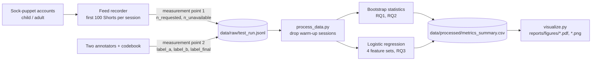

# Domain Model (ML / AI track)

This file formalises what the project measures: the classifier and its loss (RQ3), the target metrics, and the study metrics for RQ1 and RQ2. Formulas use LaTeX and render on GitHub.

## 1. Notation

| Symbol | Meaning | Unit / range |
|---|---|---|
| $i$ | index of a labelled video | 1 … n |
| $x_i \in \mathbb{R}^d$ | feature vector of video $i$ (title length, AI tag, visual artifact score, audio synthetic score) | scores in [0, 1] |
| $y_i \in \{0, 1\}$ | final label: 1 = AI-generated, 0 = human-made | – |
| $z_i$ | standardised features, $z_i = (x_i - \mu) / \sigma$ (statistics of the training set only) | – |
| $w, b$ | classifier weights and bias | – |
| $\sigma(t)$ | logistic function, $\sigma(t) = 1 / (1 + e^{-t})$ | (0, 1) |
| $p_i$ | predicted probability that video $i$ is AI-generated | (0, 1) |
| $C$ | inverse regularisation strength (fixed, $C = 1$) | > 0 |
| $\mathrm{TP}_c, \mathrm{FP}_c, \mathrm{FN}_c$ | true positives, false positives, false negatives for class $c$ | counts |
| $s_j$ | AI share of session $j$ | % |
| $n_{req}, n_{unav}, n_{ai}$ | requested videos (100), unavailable videos, AI-generated videos in a session | counts |
| $d_a$ | change in AI share of account $a$ (session 5 minus baseline) | percentage points (pp) |
| $B$ | number of bootstrap resamples ($B = 10\,000$, seed 42) | – |

## 2. Classifier and loss function (RQ3)

The detector is a logistic regression:

$$
p_i = \sigma\left(w^\top z_i + b\right)
$$

It is trained by minimising the L2-regularised log-loss (the scikit-learn objective):

$$
\mathcal{L}(w, b) = \frac{1}{2}\lVert w \rVert_2^2 + C \sum_{i=1}^{n} \Big[ -y_i \log p_i - (1 - y_i)\log(1 - p_i) \Big]
$$

All feature sets use the same model, the same $C = 1$ (no hyper-parameter search, so the search budget is equal) and the same stratified train/test split (40 % test, seed 42). The four feature sets are: metadata-only (baseline), visual-only, audio-only and multimodal (all features).

## 3. Target metrics (RQ3)

For class $c \in \{0, 1\}$:

$$
\mathrm{Precision}_c = \frac{\mathrm{TP}_c}{\mathrm{TP}_c + \mathrm{FP}_c}, \qquad
\mathrm{Recall}_c = \frac{\mathrm{TP}_c}{\mathrm{TP}_c + \mathrm{FN}_c}, \qquad
F1_c = \frac{2\,\mathrm{TP}_c}{2\,\mathrm{TP}_c + \mathrm{FP}_c + \mathrm{FN}_c}
$$

The primary metric is the macro-averaged F1 and the effect of interest is the gain over the baseline:

$$
\text{macro-}F1 = \frac{1}{2}\left(F1_0 + F1_1\right), \qquad
\Delta_{F1} = \text{macro-}F1_{\text{multimodal}} - \text{macro-}F1_{\text{metadata-only}}
$$

The practical threshold of the study is $\Delta_{F1} \ge 0.05$. The 95 % confidence interval of $\Delta_{F1}$ is a percentile bootstrap over the test videos (the same resamples for both models).

## 4. Study metrics (RQ1, RQ2) and guardrails

AI share of one session (the error-free denominator removes unavailable videos):

$$
s_j = \frac{n_{ai,j}}{n_{req,j} - n_{unav,j}}
$$

- **RQ1 effect:** $\Delta_1 = \bar{s}_{\text{child}} - \bar{s}_{\text{adult}}$ over baseline sessions. The unit of analysis is the **session**, because videos inside one feed are not independent.
- **RQ2 effect:** $d_a = s_{a,5} - s_{a,0}$ and $\Delta_2 = \bar{d}_{\text{AI-dwell}} - \bar{d}_{\text{human-dwell}}$. The unit of analysis is the **account**. The no-dwell arm is an extra control and is not part of $\Delta_2$.
- **Uncertainty:** 95 % percentile bootstrap CI of $\Delta_1$, $\Delta_2$ and $\Delta_{F1}$ (resampling sessions / accounts / test videos, seed 42). The p-value of the one-sided Welch t-test is a secondary result:

$$
t = \frac{\bar{a} - \bar{c}}{\sqrt{s_a^2 / n_a + s_c^2 / n_c}}
$$

- **Guardrails:**
  - error rate $= \sum n_{unav} / \sum n_{req} \le 5\,\%$ per group;
  - Cohen's $\kappa = \dfrac{p_o - p_e}{1 - p_e} \ge 0.70$ between the two annotators ($p_o$ observed agreement, $p_e$ chance agreement);
  - at least 3 sessions per profile group and 3 accounts per arm.

## 5. Data flow and measurement points

